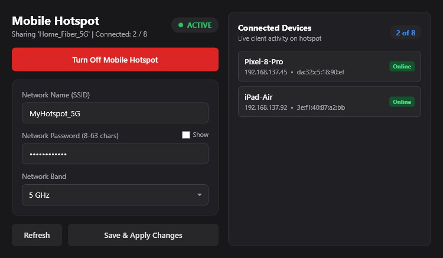
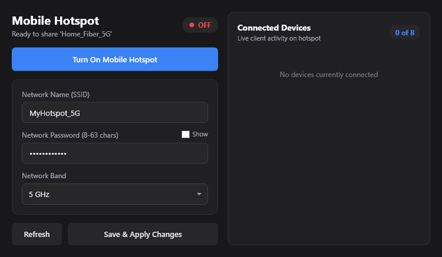

# Windows 11 Mobile Hotspot Manager

A modern, dark-themed **Windows Presentation Foundation (WPF)** dashboard and standalone executable to control and configure Windows 11 Mobile Hotspot. It directly bridges Windows 11's WinRT `NetworkOperatorTetheringManager` APIs to toggle the hotspot, customize SSID/password, select wireless frequency bands (2.4 GHz, 5 GHz, 6 GHz), and monitor connected clients in real time.

<p align="center">
  
</p>

---

## ✨ Key Features

- **Side-by-Side Modern Dashboard:** Clean two-column dark theme layout with dynamic DPI scaling.
- **Real-Time Connected Devices Monitor:** Live list of active client devices showing Hostname/Device Name, assigned IP address, and MAC address.
- **Hardware-Aware Band Selection:** Automatically queries your Wi-Fi adapter via `IsBandSupportedAsync()`. Unsupported bands (e.g. 6 GHz on Wi-Fi 6 cards) are automatically tagged and disabled to prevent radio restriction errors.
- **Auto-Apply on Toggle:** Changing the SSID, password, or frequency band and clicking **Turn On** automatically stages and saves settings before broadcasting.
- **Graceful Radio Teardown:** Safely halts the virtual SoftAP interface, verifies adapter release, and applies changes cleanly to prevent channel contention (`RadioRestriction` / `BandInterference`).
- **Zero Console Window Flashing:** The compiled `.exe` runs natively under the Windows Subsystem (`winexe`) without command prompt popups.
- **Native UAC Elevation:** Embeds an application manifest (`requireAdministrator`) so Windows displays the UAC shield icon and prompts for required elevation on launch.

<p align="center">
  
</p>

---

## 🚀 Quick Start

### Option 1: Quick Run via PowerShell One-Liner (No Install Required)
Open PowerShell and run:
```powershell
irm is.gd/win11hotspot | iex
```
*(Or via direct GitHub raw URL)*:
```powershell
irm https://raw.githubusercontent.com/seshadrianiruddh-cmd/win11-mobile-hotspot/main/HotspotManager.ps1 | iex
```

### Option 2: Standalone Executable (Recommended)
Download **`HotspotManager.exe`** from [Releases](https://github.com/seshadrianiruddh-cmd/win11-mobile-hotspot/releases).
- It is 100% self-contained (the script and UI assets are embedded directly inside).
- You can move it to your Desktop, Pin to Start, or run from a USB drive.

### Option 3: Run from Cloned Script
Right-click **`HotspotManager.ps1`** and choose **Run with PowerShell**, or launch from terminal:
```powershell
powershell.exe -NoProfile -ExecutionPolicy Bypass -STA -WindowStyle Hidden -File ".\HotspotManager.ps1"
```

---

## 🛠️ Building From Source

You can recompile `HotspotManager.exe` at any time using the built-in .NET Framework compiler (`csc.exe` included with Windows 10/11):

```powershell
.\build.ps1
```

The build script compiles `src/Program.cs` and `src/AssemblyInfo.cs` with the embedded `app.manifest`, `Hotspot.ico`, and `HotspotManager.ps1`.

---

## 📋 Requirements

- **Operating System:** Windows 11 or Windows 10 (Version 1809 or later)
- **PowerShell:** Windows PowerShell 5.1 (built into Windows)
- **Permissions:** Administrator privileges (required by Windows to access `NetworkOperatorTetheringManager`)
- **Hardware:** Wi-Fi adapter with Wi-Fi Direct / Hosted Network / SoftAP capability
